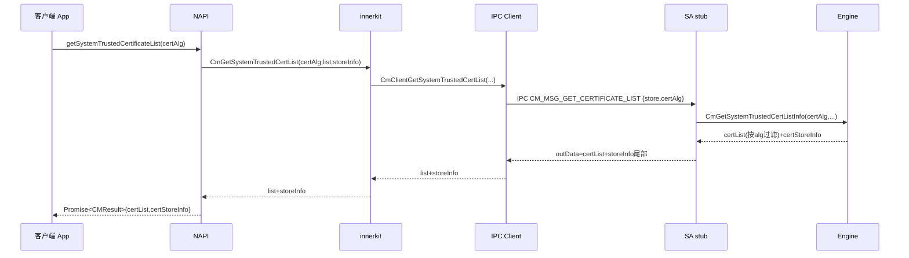

# 可行性分析

> 模板定位：评估「能不能做、值不值做」。对应生命周期「需求分析」。
> 证据场景：源码级（客户端+SA 两仓均已克隆本地，主 Session 已 Read/grep）。SA 侧未本地编译（无 OH 源码树），标注未编译验证。

## 1. 目标与范围

评估"系统预置 CA 按国际/国密算法分组展示 + 证书库版本号显示 + SA 按算法查询 + 海外无国密时不展示"的技术可行性、成本、风险。范围覆盖客户端 App（`applications_user_certificate_manager`）与 SA（`security_certificate_manager_SDD_user_certification`）两侧。本次为源码级评估（代码已实现，客户端侧已通过 `hvigorw assembleHap` 编译验证 0 error）。

## 2. 技术可行性

### 2.1 关键代码仓库分析

| 仓/模块 | 路径 | 关键接口/类 | 影响类型 | 证据来源 |
|---|---|---|---|---|
| SA-NAPI | `interfaces/kits/napi/src/cm_napi_get_system_cert_list.cpp` | `CMNapiGetSystemCertList`、`GetCertListParseParams`、`GetCertListExecute`、`GetCertListWriteResult` | 修改：解析 certAlg、调新 innerkit、序列化 certStoreInfo | 已读 302 行 |
| SA-innerkit | `interfaces/innerkits/.../cert_manager_api.h/.c` | `CmGetCertList`、新增 `CmGetSystemTrustedCertList` | 新增 API | `cert_manager_api.h:25`、`cert_manager_api.c:30` |
| SA-IPC客户端 | `frameworks/.../cm_ipc/src/cm_ipc_client.c` | `CmClientGetCertList`、新增 `CmClientGetSystemTrustedCertList` | 新增 | `cm_ipc_client.c:105` |
| SA-IPC服务端 | `services/.../cm_ipc/cm_ipc_service.c` | `CmIpcServiceGetCertificateList` | 修改：读可选 certAlg、调新 pack | `cm_ipc_service.c:81` |
| SA-打包 | `services/.../cm_ipc/cm_ipc_service_cert_pack.c` | `CmServiceGetCertListPack`、新增 `CmServiceGetSystemTrustedCertListPack`/`CmCertStoreInfoPack` | 新增 | `cm_ipc_service_cert_pack.c:94` |
| SA-引擎 | `services/.../cert_manager_engine/main/core/src/cert_manager_query.c` | `CmGetCertListInfo`、新增 `CmGetSystemTrustedCertListInfo` | 新增：按 alg 过滤+版本号 | `cert_manager_query.c:584` |
| SA-IPC码 | `frameworks/.../include/cert_manager_service_ipc_interface_code.h` | `CM_MSG_GET_CERTIFICATE_LIST` | 复用（不新增消息码） | `:27` |
| SA-类型 | `interfaces/innerkits/.../cm_type.h` | 新增 `enum CmCertAlgorithm`、`struct CmCertStoreInfo` | 新增 | `cm_type.h:415` 区 |
| 客户端 | `certmanager/src/main/ets/pages/trustedCa.ets` | `TrustedEvidence` 系统 Tab `ForEach(sysCaItems)` | 修改 | `trustedCa.ets:713` |
| 客户端 | `certmanager/src/main/ets/presenter/CmShowSysCaPresenter.ets` | `updateSystemTrustedCertificateList`、`rebuildSysCaItems` | 修改 | 整文件 |
| 客户端 | `certmanager/src/main/ets/model/CertMangerModel.ets` | 新增 `getSystemTrustedCertificateListByAlg` | 新增 | `:315` |

### 2.2 候选技术路径

#### 决策点 D1：SA 按算法过滤的算法判定
- **D1-A cm_x509 公钥解析**：解析每个系统 CA 公钥，SM2/SM3 归国密，其余国际。证据：`cm_x509.c`（`cert_manager_query.c:22` include）已具备 X509 解析能力。
- **D1-B SM2 OID 字节匹配**（当前实现）：读证书文件字节匹配 SM2 OID `1.2.156.10197.1.301`。证据：`cert_manager_query.c::GetSystemCertAlgorithm`。
- **D1-C 证书文件目录约定**：系统证书按算法分目录存放，按目录归属判定。证据：`config/systemCertificates/` 当前未按算法分目录（125 个哈希命名文件混排）。

#### 决策点 D2：证书库版本号来源
- **D2-A 镜像预置版本文件**（当前实现假设）：`/etc/security/certificates/cert_store_version` 两行文本。证据：`cert_manager_query.c::ReadCertStoreVersion`。
- **D2-B RDB 属性库**：`cm_cert_property_rdb.cpp` 存储版本。证据：引擎 rdb 模块存在。
- **D2-C 编译宏注入**：版本号宏写进二进制。

#### 决策点 D3：IPC 参数携带方式
- **D3-A 复用 CM_MSG_GET_CERTIFICATE_LIST + 可选 CmParamSet tag + 响应尾部追加**（当前实现）：`CM_TAG_PARAM1_UINT32=certAlg`，outData 尾部追加 `CmCertStoreInfo`。
- **D3-B 新增独立消息码** `CM_MSG_GET_SYSTEM_CERT_LIST_BY_ALG`：四件套全量新增。

#### 决策点 D4：客户端分组渲染
- **D4-A 单 List + ForEach(sysCaItems)**（当前实现）：分组头与证书条目混排单 List。
- **D4-B 双 List 分段**：国际段 List + 国密段 List。
- **D4-C LazyForEach + 自定义 IDataSource**：分组数据源。

### 2.3 IPC 调用链路（D3-A，已实现）

## 3. 竞品参考

| 竞品/方案 | 做法 | 可借鉴点 |
|----------|------|---------|
| 无 | — | — |

> 证据受限：未提供带来源链接的竞品 PoC；本需求为系统能力增强，竞品参考不作为可行性判断依据。用户已确认接受无竞品参考（见 `_draft/feasibility-clarification-questions.md` FQ-3）。

## 4. 成本与收益

### 4.1 各方案工作量估算（500 行≈1 人月；测试=开发×0.3；设计=开发×0.1；UX=开发×0.1 当涉及 UX）

| 决策点 | 方案 | 开发行数 | 开发(人月) | 测试 | 设计 | UX | 端到端(人月) |
|---|---|---|---|---|---|---|---|
| D1 | D1-A cm_x509 | 120 | 0.24 | 0.07 | 0.02 | — | 0.33 |
| D1 | D1-B SM2 OID（当前） | 50 | 0.10 | 0.03 | 0.01 | — | 0.14 |
| D1 | D1-C 目录约定 | 30 | 0.06 | 0.02 | 0.01 | — | 0.09 |
| D2 | D2-A 版本文件（当前） | 40 | 0.08 | 0.02 | 0.01 | — | 0.11 |
| D2 | D2-B RDB | 120 | 0.24 | 0.07 | 0.02 | — | 0.33 |
| D2 | D2-C 编译宏 | 20 | 0.04 | 0.01 | 0.00 | — | 0.05 |
| D3 | D3-A 复用消息+可选tag（当前） | 180 | 0.36 | 0.11 | 0.04 | — | 0.51 |
| D3 | D3-B 新增消息码 | 260 | 0.52 | 0.16 | 0.05 | — | 0.73 |
| D4 | D4-A 单List+ForEach（当前） | 120 | 0.24 | 0.07 | 0.02 | 0.02 | 0.35 |
| D4 | D4-B 双List分段 | 150 | 0.30 | 0.09 | 0.03 | 0.03 | 0.45 |
| D4 | D4-C LazyForEach+数据源 | 200 | 0.40 | 0.12 | 0.04 | 0.04 | 0.60 |

### 4.2 各方案工作量对比汇总

| 决策点 | 当前实现方案 | 当前端到端(人月) | 备选方案 | 备选端到端(人月) |
|---|---|---|---|---|
| D1 | D1-B | 0.14 | D1-A / D1-C | 0.33 / 0.09 |
| D2 | D2-A | 0.11 | D2-B / D2-C | 0.33 / 0.05 |
| D3 | D3-A | 0.51 | D3-B | 0.73 |
| D4 | D4-A | 0.35 | D4-B / D4-C | 0.45 / 0.60 |

> 当前实现端到端合计 ≈ 0.14+0.11+0.51+0.35 = **1.11 人月**（SA+客户端核心链路）。另含客户端 d.ts/Model/Presenter/VO/资源约 0.4 人月，总计约 **1.5 人月**。

### 4.3 收益（定性优先）
- 国密算法证书可识别性：系统 CA 按算法分类展示，用户与运维可区分国际/国密。
- 证书库版本可追溯：版本号展示便于问题定位与版本对齐。
- 海外体验一致性：无国密设备不展示空分组。
- 收益为定性能力增强，无直接量化业务指标。

## 5. 风险

| 风险 | 等级 | 缓解措施 |
|------|------|---------|
| R1 SA 侧未本地编译验证（Windows 无 OH 工具链） | 中（有验证计划） | 已确认计划在 OH 源码树 `./build.sh --build-target certmanager/cert_manager_service` + `cm_sdk_test` 验证；Owner/时点待 Phase 1 补 |
| R2 D1-B 启发式对 PEM 证书可能漏判（仅扫 DER 字节） | 中 | 改 D1-A cm_x509 公钥解析（用户倾向）；或读取后 base64 解码再匹配 |
| R3 版本号来源与维护流程未定（D2 各方案依赖镜像/构建侧） | 中 | 由 03-arch-decision-record 决策版本号来源与 Owner |
| R4 NDK/ANI/CJ 多接口形态未同步 | 中 | 按 AGENTS.md 架构约束后续补四形态 |
| R5 IPC 向后兼容 | 低 | 可选 tag + 尾部字节，旧客户端不受影响（已验证 client unpack 不校验总长） |
| R6 海外设备 SM 查询异常 | 低 | 列表为空即不渲染 SM 段（已实现判空） |

## 6. 结论建议

> 仅给可行性判断（✅可行/⚠️有条件可行/❌不可行），不含选型推荐。选型由 `03-arch-decision-record.md` 用户决策。

| 决策点 | 方案 | 可行性 | 依据 |
|---|---|---|---|
| D1 | D1-A cm_x509 公钥解析 | ✅ 可行 | cm_x509.c 已具备解析能力；正式、准确 |
| D1 | D1-B SM2 OID 匹配（当前） | ⚠️ 有条件可行 | 启发式，PEM 需解码，存在漏判风险 |
| D1 | D1-C 目录约定 | ⚠️ 有条件可行 | 依赖镜像侧按算法分目录，当前未分 |
| D2 | D2-A 版本文件（当前） | ⚠️ 有条件可行 | 需镜像构建侧预置版本文件与维护流程 |
| D2 | D2-B RDB | ✅ 可行 | rdb 模块存在，但需表结构变更与升级兼容 |
| D2 | D2-C 编译宏 | ⚠️ 有条件可行 | 版本号硬编码，升级需重编 |
| D3 | D3-A 复用消息+可选tag（当前） | ✅ 可行 | 向后兼容，免消息码 CODEOWNERS 强审查 |
| D3 | D3-B 新增消息码 | ✅ 可行 | 符合四件套，但触发 CODEOWNERS 审查 |
| D4 | D4-A 单List+ForEach（当前） | ✅ 可行 | 与既有用户 Tab 模式一致，已编译验证 |
| D4 | D4-B 双List分段 | ⚠️ 有条件可行 | ArkUI 嵌套垂直滚动需谨慎处理 |
| D4 | D4-C LazyForEach+数据源 | ✅ 可行 | 性能更优，需新增数据源类 |

整体可行性：本需求技术可行，客户端侧已编译通过；SA 侧代码链路完整但未编译验证（R1）。关键待决策项为 D1（算法判定正式化）与 D2（版本号来源），转 `03-arch-decision-record.md` 由用户决策。
